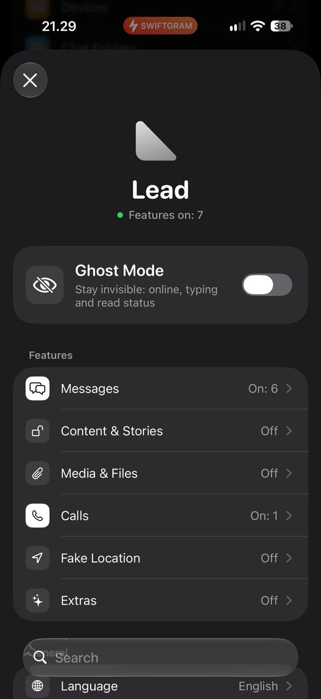
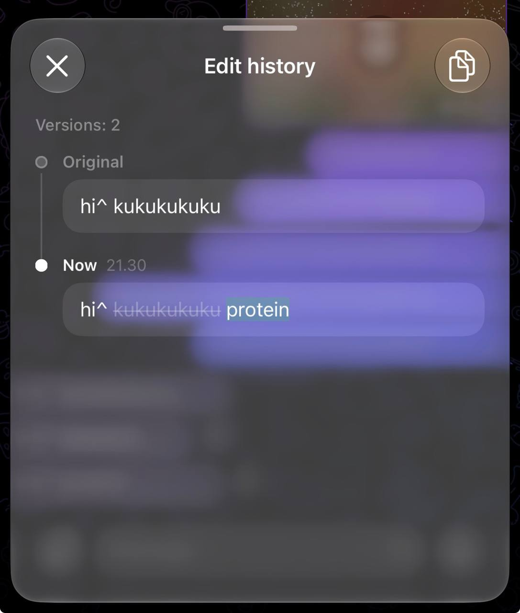
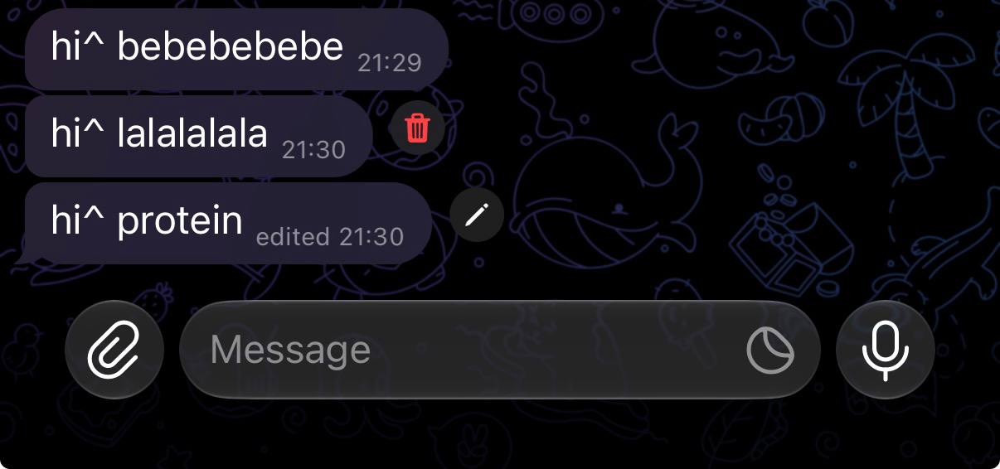
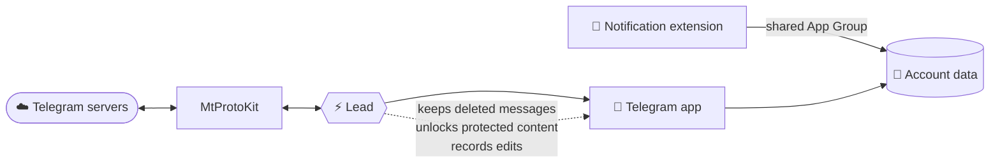

<picture>
  <source media="(prefers-color-scheme: dark)" srcset="assets/banner-dark.svg">
  
</picture>

<p align="center">
  
  
  
  
</p>

<p align="center">
  <a href="https://t.me/leadgramm"></a>
  <a href="https://github.com/w3ltyyy/lead/stargazers"></a>
  <a href="https://github.com/w3ltyyy/lead/commits/main"></a>
</p>

<p align="center">
  <a href="#-a-quick-look">Screenshots</a> &nbsp;•&nbsp;
  <a href="#-features">Features</a> &nbsp;•&nbsp;
  <a href="#-installation">Installation</a> &nbsp;•&nbsp;
  <a href="#-compatibility">Compatibility</a> &nbsp;•&nbsp;
  <a href="#-how-it-works">How it works</a> &nbsp;•&nbsp;
  <a href="#-building-from-source">Build</a>
</p>

> [!TIP]
> **Open the menu:** Telegram → **Settings** → long-press **Ask a Question**.

<br>

## 📸 A quick look

<table align="center">
  <tr>
    <td align="center" width="34%"></td>
    <td align="center" width="66%"></td>
  </tr>
  <tr>
    <td align="center"><sub><b>One quiet menu</b> — everything grouped, with search</sub></td>
    <td align="center"><sub><b>Edit history</b> — every version, changes highlighted</sub></td>
  </tr>
  <tr>
    <td align="center" colspan="2"></td>
  </tr>
  <tr>
    <td align="center" colspan="2"><sub><b>🗑 deleted</b> and <b>✏️ edited</b> marks right in the chat — tap them for details</sub></td>
  </tr>
</table>

<br>

## ✨ Features

<table>
  <tr>
    <td valign="top" width="50%">

### 👻 Ghost Mode
- **Stay invisible** — no online status, no read receipts for messages and stories
- **Hide activity** — typing, recording, uploading and every other status, each on its own switch
- **Read on reply** — chats stay unread until you answer
- **Keep voice unplayed** — listen without marking as played
- **Exceptions** — switch ghost mode off for a chat from its profile

</td>
    <td valign="top" width="50%">

### 💬 Messages
- **Anti-Revoke** — deleted messages stay, marked with 🗑 and the exact time
- **Edit history** — ✏️ on edited messages, every version with a diff
- **Message log** — all deleted & edited messages in one place
- **Deletion banner** — optional pop-up when someone deletes a message
- **Profile changes log** — names, usernames and photos
- **Anti self-destruct** & **anti auto-delete**
- **Forward without author** · **no screenshot alerts**

</td>
  </tr>
  <tr>
    <td valign="top">

### 🔓 Content & Stories
- **Save restricted media** — forward, copy and save from protected channels, groups and chats
- **No ads** and **no proxy sponsor channel**
- **App Store–restricted chats** become visible
- **Save deleted stories**, **unlock story saving**, **hide stories**

</td>
    <td valign="top">

### 🧰 Media, Calls & Extras
- **Send audio as voice**
- **Confirm calls** — no accidental dialing
- **Fake location** — any point on the map
- **`#` on profiles** — ID and estimated sign-up year
- **Settings export / import**, 10 languages, search
- **Diagnostics log** for bug reports

</td>
  </tr>
</table>

<br>

## 📦 Installation

### 📲 Sideload — no jailbreak

Ready-made IPAs are posted in the [channel](https://t.me/leadgramm).

> [!IMPORTANT]
> Lead is **already inside** the IPA — sign it as usual and **don't add the dylib again**.
> The **sideload fix is built in**, so a separate “sideload fixer” dylib isn't needed.

> [!NOTE]
> Notifications with message text work when your signing supports **App Groups**.

**Injecting Lead yourself** (decrypted IPA required) — into the app *and* its notification extension:

```bash
python3 tools/inject_ipa.py Telegram.ipa --dylib packages/Lead.dylib
```

### 🔓 Jailbreak

Install the `.deb` from the [channel](https://t.me/leadgramm) with your package manager, then restart Telegram.

<br>

## 🧩 Compatibility

| | App | Status |
|:-:|---|---|
| ✅ | **Telegram 13.2** | Everything works |
| ✅ | **Turrit 1.5.8** | Everything works |
| ✅ | **Swiftgram 13.1.2** | Everything works |
| ⚠️ | **Nagram 13.1.1** | Same API as the others, not fully tested yet |

> [!WARNING]
> With the **Rust MTProto** engine enabled in Telegram's Debug menu, network features can't work. Lead shows a warning in its menu when that happens.

<br>

## 🧠 How it works

Lead sits between Telegram and the network. It reads what the server sends, adjusts it, and hands it back, so Telegram itself does the rest — no private Swift hooks, which is why it works without a jailbreak.



<br>

## 🛠 Building from source

<details>
<summary><b>Build the tweak</b></summary>
<br>

Requires [Theos](https://theos.dev).

```bash
make package FINALPACKAGE=1
```

The `.deb` lands in `packages/`, the dylib in `.theos/_/Library/MobileSubstrate/DynamicLibraries/`.

</details>

<details>
<summary><b>Update for a new Telegram version</b></summary>
<br>

Regenerate the embedded API from Telegram-iOS's `swift_scheme.tl` — not `schema.json`, which lags behind:

```bash
python3 tools/gen_api.py <Telegram-iOS>/submodules/TelegramApi/swift_scheme.tl Sources/tgapi/api_sources
```

For a fork, `tools/extract_schema.py` recovers the schema straight from its app bundle.

</details>

<br>

## ❤️ Support

Lead is free. If you'd like to support development, open **Lead → Support** in the app for donation wallets:

<p>
  
  
  
  
  
</p>

<details>
<summary><b>⚠️ Disclaimer</b></summary>
<br>

Lead is an **independent modification** of the Telegram app. It is **not affiliated with, authorized or endorsed by Telegram Messenger LLP** or any of its affiliates. It is made for personal and educational use — use it at your own risk; the author takes no responsibility for any consequences of using it.

</details>

### 🙏 Acknowledgements
- **chocolate fluffy** — for the core code this project grew from
- A fork of [Aj3radi/TGExtra](https://github.com/Aj3radi/TGExtra)

<br>

<picture>
  <source media="(prefers-color-scheme: dark)" srcset="assets/footer-dark.svg">
  
</picture>
